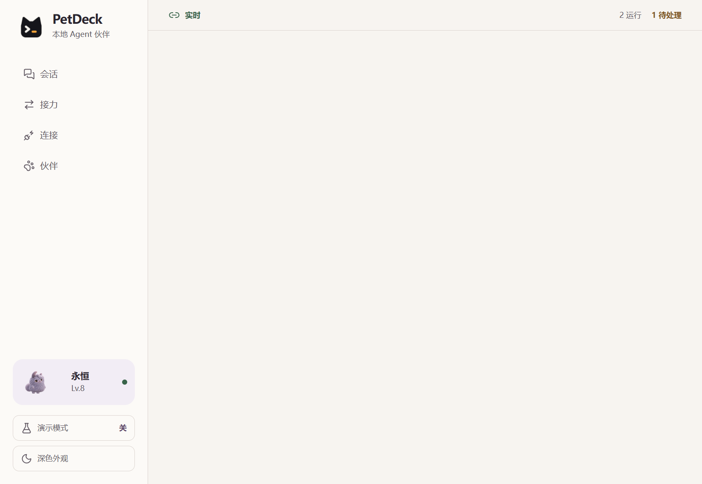
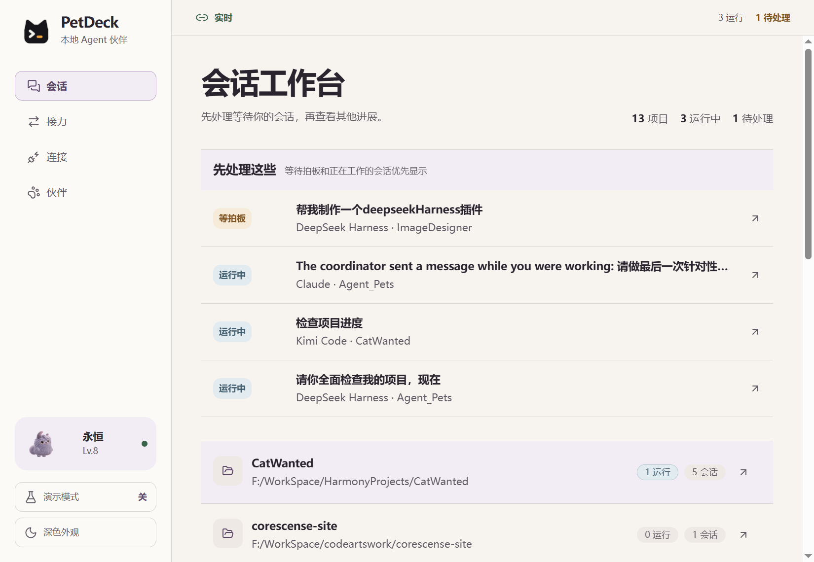
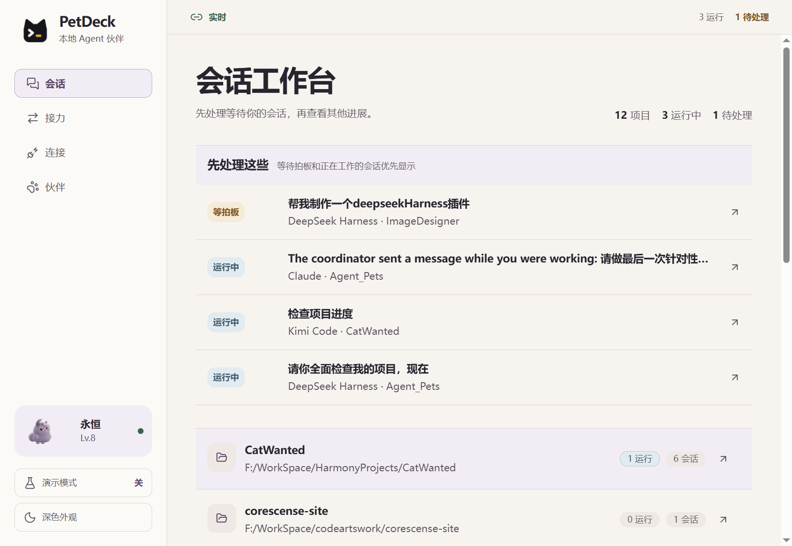
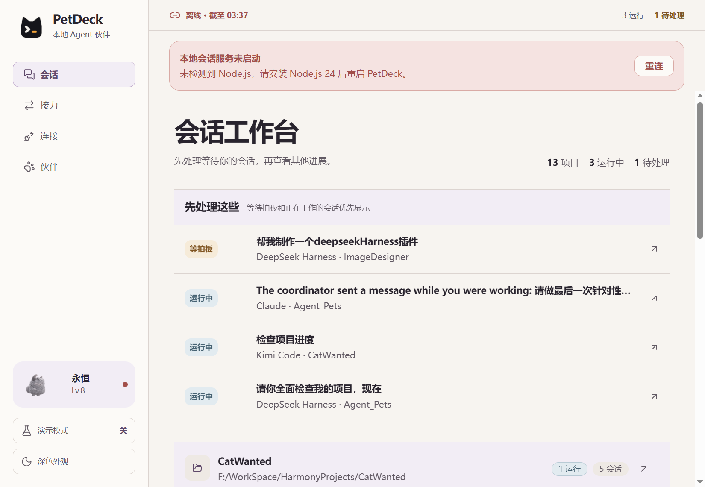

# 2026-11-20 功能可用性审计（真实数据 + 真实安装包）

> 触发：用户反馈「项目做得特别差，很多功能其实不可用，文档也有问题」。
> 方法：不看测试通过率，只拿本机真实 CLI 数据与真实安装包验证；每一条结论都附可重跑的证据。
> 环境：Windows 10.0.19045 · Node v24.18.0 · 仓库 v0.1.2（分支 `fix/production-code-splitting`，审计时工作区有 71 个未提交文件）。
> 结论口径：**自动化测试通过 ≠ 产品可用**。本次所有「已修复」项都以真实数据复测为准。

## 结论摘要

| # | 模块 | 审计前 | 审计后 | 证据 |
| --- | --- | --- | --- | --- |
| 1 | 生产安装包主窗口 | **内容区整块空白**，只剩侧栏 | 已修，生产包复核通过 | 真实安装包经 WebView2 CDP 取 DOM |
| 2 | Codex 会话 | 标题 5/5 空、cwd 4/5 空 | 标题与 cwd 全部正确 | 真实 `~/.codex/sessions` |
| 3 | DeepSeek Harness 会话 | cwd 5/5 空 | 全部正确 | 真实 `~/.dsh/sessions` |
| 4 | Kimi Code 会话 | 读的是迁移前的旧库，5 条几个月前的老会话 | 改读 v2 库，按 archived 过滤 | 真实 `~/.kimi-code` |
| 5 | Cursor 会话 | 标题 5/5 带时间戳前言、项目名被改写成短横线串 | 标题干净、项目名可读 | 真实 `~/.cursor/projects` |
| 6 | Claude 会话 | 标题 2/4 是图片占位/hook 噪声 | 改用 `ai-title`，噪声不再进标题 | 真实 `~/.claude/projects` |
| 7 | zcode 会话 | 沙箱目录被当成用户项目 | 沙箱目录不再挂项目 | 真实 `~/.zcode/cli/db/db.sqlite` |
| 8 | opencode 会话 | **整源不可用**（`fetch failed`），界面无数据 | 完全可用（5 个会话，含标题/项目/状态） | 真实 `opencode` v2.0.30 |
| 9 | 自动化测试 | 409 条全绿，但没覆盖真实结构 | 434 条，关键用例改用真实行形状 | `npm test` |
| 10 | 项目分组 | 临时注入目录被当项目；`CatWanted` 与 `CatWanted/app` 拆成两个 | 按 git 工作树根归并，临时目录单独成桶（12 项目） | 真实 bridge + 生产包面板 |
| 11 | 干净机无 Node | 面板只显示「当前离线」，不说明缺 Node | 显示启动错误原文与安装指引 | 去掉 PATH 的真实安装包 |
| 12 | 自动更新 | ROADMAP 长期未验收 | 本地签名端点跑通 0.1.2 → 0.1.3 全链路，验签负向测试通过 | 真实 NSIS 包 + Minisign |
| 13 | SSH 远程 observe | 无真实主机证据 | 传输层用本地 shim 跑通，9 条远程会话入 bridge；真实 sshd 仍未验 | `remote.mjs` + 真实探针 |
| 14 | Gemini CLI observe | 仅合成测试 | 真实结构 fixture 经 bridge 读出会话；真实 CLI 仍未安装 | 临时 `USERPROFILE` |

## 一、生产安装包：主窗口空白（最严重）

**现象**：用 release 二进制启动（`petdeck/src-tauri/target/release/petdeck.exe`，2026-11-19 构建）后，主窗口只剩左侧导航与顶部状态条，右侧内容区整块空白；控制台反复输出 `No routes matched location "/index.html"`。

**根因**：Tauri 生产包用 `http://tauri.localhost/index.html` 载入主窗口，而 `petdeck/src/App.jsx` 用的是无 basename 的 `BrowserRouter`，路由表只有 `/`、`/panel`、`/connect`、`/pet`、`/relay`。路径是 `/index.html` 时一条路由都匹配不上，`/` → `/panel` 的重定向也不会发生。开发态用 vite 以 `/` 打开，所以本地开发、浏览器验证、自动化测试全部看不到这个问题——这正是 ROADMAP P0 里长期挂着的「v0.1.2 生产窗口启动报错，整项未验收」。

**修复**：新增 `petdeck/src/desktop/entry-path.ts`（纯函数 `entryRedirect` + `normalizeEntryLocation`），在 `petdeck/src/main.jsx` 挂载 Router 之前把 `/index.html` 归一化成 `/`；`src/desktop/entry-path.test.ts` 覆盖生产路径、查询串/哈希、子目录、真实路由不受影响、大小写。

**复核（2026-11-20，真实安装包）**：必须用 `npm run tauri:build` 产出的二进制，理由见下面的「构建方式陷阱」。启动时设 `WEBVIEW2_ADDITIONAL_BROWSER_ARGUMENTS=--remote-debugging-port=9444`，WebView2 报出的 target 由修复前的 `http://tauri.localhost/index.html` 变为 **`http://tauri.localhost/panel`**；读 `document.body.innerText` 得到完整面板（「会话工作台」「13 项目 / 3 运行中 / 1 待处理」以及项目卡片）。

修复前（内容区空白，只剩 shell）：



修复后（同一台机器、同一个真实安装包）：



桌宠独立窗口（`pet.html`）本身没有这个问题，修复前后都正常：


**构建方式陷阱（会误导验证）**：

- 直接 `cargo build --release` 得到的是 **14 MB 的开发态二进制**（原包 18 MB）：它加载 `tauri.conf.json` 的 `devUrl`（`http://localhost:5183`），只有在 vite dev 同时运行时看起来才"正常"。本次复核前一度用它误判为"修好了还没修好"，必须用 `npm run tauri:build`（embed dist）才能证明生产可用。
- `npm run tauri:build` 在本机未设 `TAURI_SIGNING_PRIVATE_KEY` 时会在最后给更新包签名时 **exit 1**，但 exe 与 NSIS 安装包已经产出（`target/release/bundle/nsis/PetDeck_0.1.2_x64-setup.exe`）。只看到退出码 1 就判"构建失败"同样会误判；发布流程见 [自动更新与签名](自动更新与签名.md)。
- 由此回看 [真机实测矩阵](真机实测矩阵.md) 2026-11-19 的「两种方式下桌宠与主面板均正常渲染」：当时 vite 很可能仍在运行，实际跑的是加载 devUrl 的二进制。该结论不能作为生产包证据，已在矩阵中加注。

## 二、适配器层：409 个测试全绿，真实数据大面积对不上

**总根因（比单个 bug 重要）**：适配器是照着「假设的存储结构」写的，而单元测试的 fixture 也照着同一个假设造，于是测试全绿、产品全错。凡是没有拿真实 CLI 产物跑过一遍的数据源，都不可信。

### 2.1 Codex（`server/adapters/codex.mjs`）

- cwd 4/5 为空：`session_meta` 只在 rollout 的**第 1 行**，而观察只读尾部 400 行；长会话（实测 6192 行）的首行落在窗口外。
- 标题 5/5 为空：原实现找 `payload.type === 'user_message'`，真实数据里**不存在**这个类型。标题真正的来源是
  `{"type":"event_msg","payload":{"type":"item_completed","item":{"type":"UserMessage","content":[{"type":"text","text":"…"}]}}}`。
- 另有一个坑：第 3 行往往是整份 AGENTS.md（单行约 100 KB），按字节封顶的 `headLines(file, 60, 64KB)` 只能读到 2 行，用户提问（第 9–13 行）依然读不到。
- 修复：`shared.mjs` 的 `headLines` 改为 64 KB 分块读到够行数为止（上限 1 MiB、丢弃截断尾行）；codex 用 `headLines(f, 60) + tailLines(f, 400)`；标题改用 `item_completed/UserMessage`，并过滤 `# AGENTS.md` 等注入前缀。
- 复测：标题、cwd 全部正确（例：「请你按照项目进度开始做 **ST-03 故事与纪念册视频输出**」）。

### 2.2 DeepSeek Harness（`dsh.mjs`）

- cwd 5/5 为空：真实 `session` 事件是**扁平**的 `{"type":"session","version":4,"id":"session-…","cwd":"F:\\…"}`，适配器却去读 `e.data.cwd`。
- 修复：`e.id ?? e.data?.id`、`e.cwd ?? e.data?.cwd`；`session/title`、`turn/start`、`assistant/message` 原本就读 `data`，未动。

### 2.3 Kimi Code（`kimi-code.mjs`）——读错了整整一代存储

- `~/.kimi/.migrated-to-kimi-code` 早就存在，CLI 已迁到 `~/.kimi-code`；适配器仍读 `~/.kimi/sessions/<hash>/<uuid>/context.jsonl`，于是界面显示的是**几个月前的 5 条旧会话**，标题还是系统压缩提示 `<system>Previous context has been compacted…`。
- 新库权威结构：`~/.kimi-code/session_index.jsonl`（`sessionId`/`sessionDir`/`workDir`）+ `<sessionDir>/state.json`（`id/cwd/archived/title/titleKind/lastPrompt/createdAt/updatedAt`）+ 正文 `<sessionDir>/agents/main/wire.jsonl`（协议 1.5 事件流：`turn.prompt`/`context.append_message`/`usage.record`/`turn.ended`/`prompt.completed`）。
- 修复：新增 `parseKimiWire`，主路径改读 v2 并按 `archived` 过滤（本机 571 个 `state.json` 中绝大多数是归档）；旧 v1 解析保留为兜底，并对压缩提示做过滤。

### 2.4 Cursor（`cursor.mjs`）

- 标题 5/5 带 `<timestamp>Friday, Oct 2, 2026, 9:07 PM (UTC+8)</timestamp>` 前言：真实首条 user 文本被包在 `<user_query>…</user_query>` 里。
- 项目名被改写成 `f-WorkSpace-AIProjects-AIAPPPlan-TalkProject`：工程目录名是**有损转义**（盘符小写、`:`/`\\`/`_` 一律变 `-`），无法反推原路径。
- 修复：`cleanUserText`（去时间戳、取 `user_query` 内文）+ `humanizeProject`（去掉 `f-` 前缀、按 `-` 切分、取末两段 → `AIAPPPlan/TalkProject`）；projectId 保留原始 slug 以保证分组稳定。

### 2.5 Claude（`claude.mjs`）

- 标题 4 条里 2 条是噪声：`[Image: original 1260x2720, displayed at 926x2000…]`、`Stop hook feedback:\n[node "C:\\Users…`。
- 真实标题来源是 `{"type":"ai-title","aiTitle":"小爪邮局素材接入"}`（本机 784 条），而 `user` 行里还混着 `<system-reminder>`、`<command-` 等注入内容。
- 修复：优先 `ai-title`；`user` 兜底标题加 `looksLikePrompt` 过滤。

### 2.6 zcode（`zcode.mjs`）

- 5 条里 1 条的 cwd 是 zcode 自己的沙箱目录 `E:\\ZCodeData\\.zcode\\workspace\\1794927028429-<uuid>`，会凭空造出一个项目。
- 修复：`isSandboxDirectory()` 命中则 cwd 置空，界面按既有设计显示「未识别项目」（文案「zcode 未提供项目路径或标识」）。

### 2.7 opencode（`opencode.mjs` + `exec.mjs`）——整源不可用

- 现象：`observe()` 抛 `fetch failed`，health 里 `ok:false`，界面完全没有 opencode 数据。
- 根因一（Windows）：`exec.mjs` 用 `shell:false` 直接 spawn。Node 不按 PATHEXT 解析，`spawn('opencode')` → `ENOENT`；`spawn('opencode.cmd')` → `EINVAL`（Node ≥20.12 禁止无 shell 直接 spawn `.cmd`）。本机 opencode/dsh 只以 `%APPDATA%\\npm\\opencode.cmd` 形式存在（codex/claude/kimi/ssh 是真 `.exe`，所以只有这两个源坏）。
- 根因二（字段）：真实 v2 payload 的项目路径在 `location.directory`，适配器读的是 `s.directory`。
- 修复：`exec.mjs` 新增 `resolveExecutable`（按 PATHEXT 解析、`.exe`/`.com` 优先于 `.cmd`/`.bat`、跳过无扩展名 sh shim）与 `quoteForCmd`，命中 `.cmd`/`.bat` 时改走 `cmd.exe /d /s /c`；`directoryOf()` 兼容 `location.directory`。
- 复测：`runCli('opencode', ['api','session.list'])` 返回 26 KB JSON；`observe()` 5 条会话，标题干净（`License batch review r3`），cwd `F:\\WorkSpace\\HarmonyProjects\\Workflow`。

## 三、前端真实数据验证（浏览器 + 真实 bridge）

- 起真实 bridge（`PETDECK_BRIDGE_PORT=5199`）+ `vite dev`（5183），用 headless Chrome 走 CDP 逐路由取 DOM 与截图。
- `/panel`：13 个项目、3 运行中、1 待处理，项目名可读（CatWanted、corescense-site、Agent_Pets、Workflow、DevBox、毛爪卡册、ImageDesigner、AIAPPPlan/TalkProject、AIProjects/OpenAgent、App/Develop），另有 1 个「未识别项目」属 zcode 沙箱会话（预期行为）；四条路由无 console 异常。
- `/connect`：按 tier 正确区分「观察+接力」（Codex/Claude/opencode）与「仅观察」。
- `/relay`：未带来源会话时提示「请先选择源会话」，符合设计。
- Tauri 桌宠窗口（`pet.html`）：宠物与状态角标渲染正常。

## 四、为什么之前没被发现（过程问题）

1. **测试 fixture 与实现同源**：fixture 是按假设手写的，真实 CLI 一升级/一迁移就全线失配，而测试依然全绿。
2. **开发态与生产态入口不同**：vite 走 `/`，Tauri 走 `/index.html`，本地怎么点都发现不了生产空白。
3. **矩阵文档替代了复测**：`docs/真机实测矩阵.md` 的结论是当时的事实，但 kimi-code 一栏写的「`context.jsonl` 解析正常」实为迁移前旧库，被当成「已验证」沿用。
4. **只验代码不验安装包**：生产包只做「能启动」判断，没验证窗口内容是否渲染。

## 五、本次未修 / 已知残留

| 项 | 现状 | 建议 |
| --- | --- | --- |
| `/pet` 在浏览器壳内近乎空白 | 设计上桌宠是独立 `pet.html` 窗口，壳内该路由只是预览 | 若要保留，补一段预览说明或改为跳转 |
| kimi-code v1 旧库兜底仍在 | 仅作兼容，不产生数据（已按 archived 过滤） | 观察一个版本后删除 |
| 真实 SSH 主机 | 传输与探针已用本地 shim 验证；真实 sshd 未接入（本机非管理员，无法安装 OpenSSH Server） | 在一台有 sshd 的主机回填矩阵 |
| 真实 Gemini CLI | 适配器用真实结构 fixture 验证；本机未安装 CLI、无凭证 | 在装有 Gemini CLI 的机器补 observe |
| GitHub Releases 更新链路 | 本地签名端点全链路通过；含修复的版本尚未发布 | 发版后重跑 0.1.x → 0.1.y |
| Windows 系统 toast 视觉 | 通道可用（permission granted / plugin true），但本机 `ToastEnabled=0`，系统级关闭了 toast | 开启系统通知后再做一次视觉确认 |

## 六、验证方式（可重跑）

```powershell
# 1) 适配器直接对真实数据跑 observe()
node output/probe-adapters.mjs        # 审计期临时脚本，结论已并入本文

# 2) 五道质量门
cd petdeck
npm run docs:check
npx tsc --noEmit
npm run lint
npm test                              # 434 tests / 434 pass
npm run build

# 3) 生产包窗口验证：用 WebView2 远程调试端口读真实 DOM
$env:WEBVIEW2_ADDITIONAL_BROWSER_ARGUMENTS = '--remote-debugging-port=9444'
Start-Process petdeck/src-tauri/target/release/petdeck.exe
# 然后访问 http://127.0.0.1:9444/json/list 取主窗口 target，读 document.body.innerText
```

> `output/` 下的一次性探针脚本（`probe-*.mjs`、`ui-probe.mjs`、`tauri-*.mjs`）与日志不属于产品代码，审计结束后已删除；结论与截图已固化到本文件与 [真机实测矩阵](真机实测矩阵.md)，截图存放在 `docs/assets/2026-11-20/`。

## 七、第二轮：继续处理未验收项（2026-11-20 04:15）

### 7.1 项目分组归一化（已修）

- **口径**：子目录会话归并到最近的 **git 工作树根**（逐级向上找 `.git` 文件或目录，最多 8 层）；系统临时目录（`%TEMP%`、`/tmp`、`AppData/Local/Temp`）下的会话不再冒充项目，统一进入「临时目录」桶；临时目录里若本身是 git 检出，仍按真实项目处理（`hasMarker` 保护）。
- **实现**：新增 `petdeck/server/project-root.mjs`（`isTempDirectory` / `createRootResolver` / `canonicalizeRows`），在 `server/bridge.mjs` 的 poll 结果发布前归一化；SSE 推送 key 拼上分组键（`cwd + temp`），分组变化必定推送。前端 `src/adapters/types.ts` 增加 `temp?: boolean`，`src/adapters/session-identity.ts` 的 `projectForObservation` 识别 `temp` → `${host}:temp`，i18n 新增 `data.tempProject` / `data.tempProjectDesc`（zh/en）。
- **证据**：`server/project-root.test.mjs` 4 条用例；真实 bridge 30 行会话中 temp=1，CatWanted 6 条合并；生产包面板从 **13 项目降到 12 项目**，出现「临时目录」桶（描述「会话在系统临时目录中运行（接力注入沙箱等），不归属任何项目」，1 会话），`CatWanted` 显示「6 会话」，zcode 沙箱仍是「未识别项目」。



### 7.2 干净机无 Node：把真实原因显示出来（已修）

- **问题**：Rust 侧 `src-tauri/src/bridge.rs` 已生成明确错误（「未检测到 Node.js，请安装 Node.js 24 后重启 PetDeck。」），但前端 `configureBridgeClient` 丢弃了 `config.error`，面板只剩离线横幅。
- **修复**：`src/adapters/bridge-client.ts` 保存并导出 `bridgeConfigError()`；`src/flows/petdeck/app-shell.tsx` 在离线横幅显示 `shell.bridgeStartupTitle` + 错误原文；中英文案补齐；`src/desktop/bridge-config.test.ts` 覆盖错误透传/清空。
- **证据**：用已经包含修复的 0.1.2 测试包，在子进程内把 `PATH` 临时缩到 `C:\Windows\System32;C:\Windows` 后启动（随后立刻恢复，CDP 用 node 绝对路径），面板显示「本地会话服务未启动」+「未检测到 Node.js，请安装 Node.js 24 后重启 PetDeck。」+「重连」。



> 注意：用**旧**真实安装包做同样测试只显示通用「当前离线」——该包构建于这次修复之前。验证这类构建期修复必须用新包，否则会把「旧包没这个功能」误判成「功能没生效」。

### 7.3 自动更新：本地签名端点全链路通过（发布链路仍待）

为了不动 GitHub 发布，用 `--config` 覆盖构建了一份指向 `http://127.0.0.1:5290` 的测试包：

1. 用 `npm run tauri:build -- --config ...\v012.json` 构建 0.1.2（`createUpdaterArtifacts:false`），安装并启动。
2. 用本机生产私钥重建 0.1.3（`TAURI_SIGNING_PRIVATE_KEY` + `TAURI_SIGNING_PRIVATE_KEY_PASSWORD`），产出签名 `.sig`；本地静态服务提供 `latest.json` 与 NSIS 包。
3. CDP 调 `window.__TAURI_INTERNALS__.invoke('check_update')` 返回 `{"available":true,"version":"0.1.3",...}`，再调 `install_update`。
4. 约 50 秒后注册表 `DisplayVersion` 变为 **0.1.3**，进程仍存活，主窗口 target 为 `http://tauri.localhost/panel`，面板正常渲染；再次 `check_update` 返回 `{"available":false}`（已是最新）。
5. **验签负向测试**：篡改 `latest.json` 里真实签名行后安装被拒（`This signature algorithm is not supported by this implementation`），版本保持 0.1.2、进程存活。
6. 最后用审计前保存的真实安装包静默重装，恢复本机为 0.1.2（`petdeck.exe` 18,690,560 字节）。

**三个容易踩的坑**：

- updater 端点若用 http，必须在测试配置里显式写 `plugins.updater.dangerousInsecureTransportProtocol: true`；否则应用启动即 panic（`The configured updater endpoint must use a secure protocol like https`）。
- **重新构建必须重新签名**：`bundle/nsis/PetDeck_0.1.2_x64-setup.exe.sig` 是上一次构建的签名，和重编后的 exe 不匹配；拿旧签名去测会得到误导性的失败。
- Minisign 的 `untrusted comment` 不参与验签；只改注释不会让负向测试失败，必须改真正的签名行。

**仍未验**：GitHub Releases 上的真实 `latest.json` 与发布流程；本地端点不能替代发布后的 0.1.x → 0.1.y 复核。

### 7.4 SSH 远程 observe：传输层用本地 shim 跑通（真实主机仍待）

本机不是管理员，装不了 OpenSSH Server，因此无法起真实 sshd。用两个手段把链路拆开验证：

- `server/remote.test.mjs` 覆盖主机白名单、探针 JSON 校验、失败隔离、行数上限、`ssh host node -` 参数。
- **传输模拟**：在临时目录放一个 `ssh.cmd`，把 stdin 原样交给本机 Node 执行（等价于远端 `node -`），并只把该目录放进 `PATH`，让 `exec.mjs` 解析到 shim 而不是系统 `ssh.exe`；`PETDECK_REMOTE_HOSTS=sim-host` 启动真实 bridge。结果：探针真实扫描本机 `~/.codex` / `~/.claude`，返回 **9 条会话并全部打上 `host=sim-host`**，bridge API 共 10 行（另 1 行为 Gemini fixture）。

**已知限制**：远程探针不返回 `cwd` / `projectId`，远程会话在面板会按主机聚合、缺少项目名；真实 SSH 的认证、host key、网络失败与 stale 恢复仍未验证。

### 7.5 Gemini CLI：真实结构 fixture 经 bridge 读出（真实 CLI 仍待）

- 本机没有 Gemini CLI、也没有 `~/.gemini/tmp`；用临时 `USERPROFILE` 造了一份与官方源码一致的 JSONL（metadata + user + gemini + tokens），启动真实 bridge。
- 结果：`/api/sessions` 返回 1 条 `gemini` 行，标题「模拟提问：检查 Gemini 观察链路」、状态 `done`、项目 `gem-sim-project`，token 字段解析正确。
- 这证明 adapter + bridge 管道可用，但**不替代**真实 CLI 的会话写入行为；真实环境仍待补测。

### 7.6 Windows 系统 toast：通道可用，视觉被系统设置阻断

- 用真实安装包的 WebView2 执行：`Notification.permission === 'granted'`，`plugin:notification|is_permission_granted` 返回 `true`，`new Notification(...)` 不抛错——应用侧通道是通的。
- 但桌面截图里没有 toast，注册表也没有该应用的 `LastNotificationAddedTime`；检查发现 `HKCU\Software\Microsoft\Windows\CurrentVersion\PushNotifications` 的 **`ToastEnabled = 0`**，即系统级关闭了 toast。未擅自修改用户系统设置，因此**视觉结论仍为未验收**；开启系统通知后可复跑同一步骤。

## 八、影响面

- 代码：`server/adapters/{exec,shared,codex,dsh,kimi-code,cursor,claude,zcode,opencode}.mjs`、`src/desktop/entry-path.ts`（新）、`src/main.jsx`；第二轮新增 `server/project-root.mjs`、`server/bridge.mjs` 归一化接线、`src/adapters/bridge-client.ts` 启动错误透传、`src/adapters/{types,session-identity}.ts`、`src/i18n/messages.ts`、`src/flows/petdeck/app-shell.tsx`。
- 测试：`server/{pure,cursor,kimi-code,dsh,zcode,shared-observe,project-root}.test.mjs`、`src/desktop/{entry-path,bridge-config}.test.ts`、`src/adapters/session-identity.test.ts`；用例数 409 → 434。
- 文档：本文件、[Agent 会话存储勘察](agent-会话存储勘察.md)、[真机实测矩阵](真机实测矩阵.md)、[统一路线图](ROADMAP.md) 同步更新。
