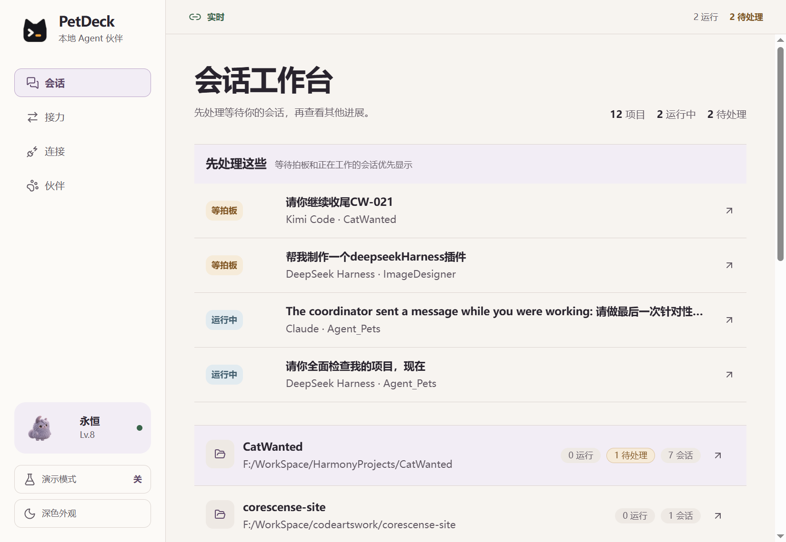

# 真机实测矩阵

> 目的：把 README「真实 CLI 兼容性尚未逐一安装版实测」的免责，变成一张可回填的事实清单。fake 测试证明逻辑正确，只有这张表证明真实链路可用。
>
> 生成方式：在本机运行 `node scripts/verify-local.mjs --md`，把输出粘贴到下表「自动检查」部分；inject 列由人工小步实测后回填（不使用本脚本自动注入）。
>
> 红线：观察只读、注入需人工确认；「未实测」必须如实保留，不得以 fake 测试替代真机结论。

## 自动检查（脚本生成，可重跑覆盖）

| 适配器 | CLI | 版本 | 会话目录 | 目录 | observe | inject |
| --- | --- | --- | --- | --- | --- | --- |
| Codex (codex) | codex | codex-cli 0.157.1 | ~/.codex/sessions | 存在 | 5 个会话 | 待实测（本脚本不注入） |
| Claude (claude) | claude | 2.1.312 | ~/.claude/projects | 存在 | 5 个会话 | 待实测（本脚本不注入） |
| opencode (opencode) | opencode | v2.0.27 | ~/.opencode + serve | 存在 | 5 个会话（`opencode api session.list`） | 待实测（本脚本不注入） |
| kimi work (kimi) | — | 未安装 | —（托管） | 存在 | 托管网页 Agent，仅观察层（人工/扩展录入） | 恒剪贴板（设计内） |
| Kimi Code (kimi-code) | kimi | 2.3.0 | ~/.kimi/sessions | 存在 | 5 个会话 | 恒剪贴板（observe-only） |
| zcode (zcode) | — | 未安装 | ~/.zcode/cli/db | 存在 | 5 个会话 | 恒剪贴板（observe-only） |
| DeepSeek Harness (dsh) | dsh | 0.2.1-rc.2 | ~/.dsh/sessions | 存在 | 4 个会话 | 恒剪贴板（observe-only） |
| Cursor (cursor) | cursor | 3.29.15 | ~/.cursor/projects | 存在 | 5 个会话 | 恒剪贴板（observe-only） |
| Gemini CLI (gemini) | — | 未安装 | ~/.gemini/tmp | 缺失 | —（本机无数据） | 恒剪贴板（observe-only） |

> 上表为 2026-11-16 在真实开发机（Windows 10.0.19045 · Node v24.18.0）运行 `node scripts/verify-local.mjs` 的结果。

## 人工实测回填（observe 后逐项小步验证 inject）

实测方法：在系统临时空目录中直接调用适配器的 `inject()`，指令为「只回复 OK，不使用任何工具，不读取或修改文件」；超时沿用适配器默认值（codex/claude 60s，opencode 120s）。

| # | 适配器 | CLI 版本 | OS | observe 结果 | inject 结果 | 降级路径 | 日期 | 备注 |
| --- | --- | --- | --- | --- | --- | --- | --- | --- |
| 1 | codex | 0.157.1 | Windows 10.0.19045 | 成功（5 个会话） | 成功（约 10.4s，返回 OK） | — | 2026-11-16 | 首次实测受本机 CC Switch 模型路由阻塞；修正配置后适配器 `codex exec` 注入成功 |
| 2 | claude | 2.1.312 | Windows 10.0.19045 | 成功（5 个会话） | 成功（约 4s，返回 OK） | — | 2026-11-16 | 原参数缺 `--verbose` 直接 exit 1；已修复适配器并解析 stream-json |
| 3 | opencode | 2.0.27 | Windows 10.0.19045 | 成功（v2 `opencode api session.list`，5 个会话，约 173ms） | 成功（约 4.9s，返回 OK + sessionID） | — | 2026-11-16 | v2 使用动态端口 + CLI 管理密码；旧 `/session` 路径已返回 Web UI；SSE `session.execution.started` 实测可把运行中会话标为 `running`，终态后回 `done` |
| 4 | kimi | — | Web | 托管网页 Agent，仅观察层 | 恒剪贴板 | — | 2026-11-16 | 无注入面 |
| 5 | dsh | 0.2.1-rc.2 | Windows 10.0.19045 | 成功（4 个会话；3 done / 1 unknown） | 恒剪贴板（observe-only） | — | 2026-11-16 | 多帧 zstd 逐帧解压修复后真机通过；无回合信号的会话保持 unknown |
| 6 | kimi-code | kimi 2.3.0 | Windows 10.0.19045 | 成功（5 个会话；全部 done，含 token 用量） | 恒剪贴板（observe-only） | — | 2026-11-16 | `context.jsonl` 解析正常；`kimi-code` 可执行名未在 PATH |
| 7 | zcode | CLI 未在 PATH | Windows 10.0.19045 | 成功（5 个会话；全部 done，含 token 用量） | 恒剪贴板（observe-only） | — | 2026-11-16 | 通过只读临时副本打开 543MB SQLite |
| 8 | cursor | 3.29.15 | Windows 10.0.19045 | 成功（5 个会话；全部 done） | 未验证（3.29.15 无可用 headless 子命令） | 剪贴板 | 2026-11-16 | 7 个顶层 transcript（6 success / 1 error）；子代理 transcript 已跳过；`agent`/`desktop` 子命令未接线 |
| 9 | gemini | — | Windows 10.0.19045 | 未实测（本机未安装，无 `~/.gemini/tmp`） | 恒剪贴板（observe-only） | — | 2026-11-16 | 按 google-gemini/gemini-cli 官方源码实现，仅有合成测试 |

> dsh / kimi-code / zcode / cursor / gemini 均为 tier=`observe-only`，inject 恒走剪贴板；真机 observe 结果见第 5–9 行。

回填约定：inject 结果填写「成功 / 失败(code) / 降级成功」三态之一；同一天重测覆盖旧值并更新日期；发现新版本 CLI 破坏行为时新增一行而不是改旧行。

## 已知未验证项（诚实清单）

- codex `exec` 注入：2026-11-16 真机成功（0.157.1，约 10s）；此前本机 CC Switch 模型路由问题已排除。
- claude `stop_reason`/结果类型对「完成 vs 运行」的判定：合成 fixture 已测，真实 jsonl 未比对过所有状态组合。
- Gemini CLI：本机未安装，仅按官方源码实现与合成测试，未做真机回填。
- Cursor inject：2026-11-17 复核 Cursor 3.29.15，顶层 CLI 未接线 `agent`/`desktop` headless 子命令，安装目录也无独立 `cursor-agent`；当前恒剪贴板，待官方 CLI 可用后再验证。
- SSH 远程会话：本机未运行 SSH server，未做端到端 SSH 实测；远程探针已通过 `node -` stdin 本地验证，SSH 参数/错误路径有单测。
- 桌面安装版（NSIS）在未装 Node 24 的干净机器上的首启报错路径：有明确报错设计，未截图留档。
- 自动更新（2026-11-20 已验收）：v0.1.1 → v0.1.2 的传输段成功，但 v0.1.2 生产窗口空白导致验收失败；修复后发布 v0.1.3，已安装的 0.1.2 经真实 GitHub Releases 更新到 0.1.3，更新后主窗口正常、再次检查已是最新。

- 本地生产修复与覆盖安装（2026-11-20 修正）：2026-11-19 记录中“直接运行 `target/release/petdeck.exe` 正常”很可能跑的是加载 `devUrl` 的开发态二进制（约 14 MB），不能作为生产结论；`npm run tauri:build` 产物（约 18 MB）才嵌入 `dist`。2026-11-20 用真实构建产物与真实 GitHub Releases 0.1.2 → 0.1.3 更新再次验证，桌宠与主面板均正常渲染，未出现 `E is not a function` 与独立 Node 控制台。

## 2026-11-20 复核（真实安装包 + 真实数据）

复核动机：[2026-11-20 功能可用性审计](2026-11-20-功能可用性审计.md) 发现「409 个测试全绿、真实数据大面积对不上」，以及生产安装包主窗口空白。本节只记录**真实安装包/真实 CLI 产物**的结果，不用 fake 测试替代。

| # | 复核项 | 修复前 | 修复后（2026-11-20） | 证据 |
| --- | --- | --- | --- | --- |
| 1 | 生产安装包主窗口 | 内容区整块空白，console 报 `No routes matched location "/index.html"` | 渲染完整面板：13 项目 / 3 运行中 / 1 待处理 | `npm run tauri:build` 产物 + WebView2 CDP（target 变为 `http://tauri.localhost/panel`） |
| 2 | Codex observe | 标题 5/5 空、cwd 4/5 空 | 标题与 cwd 全部正确 | 真实 `~/.codex/sessions`（长会话 6192 行） |
| 3 | DeepSeek Harness observe | cwd 5/5 空 | 全部正确 | 真实 `~/.dsh/sessions` |
| 4 | Kimi Code observe | 读迁移前旧库，只有 5 条几个月前的老会话 | 改读 `~/.kimi-code` v2 库并按 archived 过滤 | 真实 `~/.kimi-code`（571 个 `state.json`） |
| 5 | Cursor observe | 标题 5/5 带时间戳前言、项目名是不可读 slug | 标题干净、项目名可读 | 真实 `~/.cursor/projects` |
| 6 | Claude observe | 标题 2/4 是图片占位/hook 噪声 | 改用 `ai-title`，噪声不再进标题 | 真实 `~/.claude/projects`（784 条 ai-title） |
| 7 | zcode observe | 沙箱目录被当成用户项目 | 沙箱 cwd 置空，显示「未识别项目」 | 真实 `~/.zcode/cli/db/db.sqlite` |
| 8 | opencode observe | **整源不可用**（`fetch failed`，界面无数据） | 5 个会话，标题/项目/状态正常 | 真实 `opencode` v2.0.30 |
| 9 | 自动化测试 | 409 条全绿但未覆盖真实结构 | 428 条，关键 fixture 改用真实行形状 | `npm test` |

补充事实（避免下次复核再走弯路）：

- **`cargo build --release` 不是生产包**：单独 cargo 构建得到 14 MB 开发态二进制，加载 `devUrl`（`http://localhost:5183`），vite 未运行时会看到 `ERR_CONNECTION_REFUSED` 与空白窗口；生产包必须 `npm run tauri:build`（18 MB，嵌入 `dist`）。
- **签名缺密钥会 exit 1**：本机未设 `TAURI_SIGNING_PRIVATE_KEY` 时 `tauri:build` 在最后签名步骤报错退出，但 exe 与 NSIS 安装包已产出，不代表构建失败。
- **上一行 2026-11-19 的"生产窗口正常渲染"结论需要打折**：那次很可能跑的是加载 devUrl 的二进制（vite 仍在运行），不能作为生产包证据。真正的生产包验证是本次（target 为 `tauri.localhost` 且 DOM 有面板）。
- **仍未实测**：自动更新端到端（热修复未发布）、SSH 真机、干净机 NSIS 首启、Windows 系统 toast 视觉、Gemini CLI observe。
- **新增已知噪声（未修）**：面板会出现 `%TEMP%\petdeck-inject-codex-final-*` 这类注入临时目录项目，以及父子目录拆成两个项目（`CatWanted` 与 `CatWanted/app`）；已记入审计报告「本次未修 / 已知残留」。

## 2026-11-20 第二轮复核（更新链路 / 分组 / 干净机 / SSH / Gemini / toast）

第一轮复核后继续处理「仍不可用 / 未验收」项。本节只写本轮真实执行过的内容，未做到的边界单列，不用 mock 冒充真机结论。

| # | 项目 | 方法 | 结果 | 边界 / 未验 |
| --- | --- | --- | --- | --- |
| 1 | 自动更新 | 本地 `--config` 签名端点（127.0.0.1），真实 NSIS 安装包 | 0.1.2 测试包 `check_update` 发现 0.1.3 → `install_update` → 注册表变 0.1.3、进程存活、主窗口正常、再次检查为已最新；篡改签名行后安装被拒且版本不变；结束后恢复用户真实 0.1.2 安装（18,690,560 字节） | GitHub Releases 的真实 `latest.json` 与发版流程未验；发布含修复版本后仍需重跑 |
| 2 | 项目分组 | 真实 bridge + 含修复的生产包面板 | **12 项目**（原 13）；`CatWanted` 合并为 6 会话；新增「临时目录」桶（1 会话）；zcode 沙箱仍为「未识别项目」 | 归并口径为「最近 git 工作树根」；非 git 的父子目录仍会分开 |
| 3 | 干净机无 Node | 子进程内临时去掉 Node 的 PATH，启动真实安装包，CDP 读面板 | 面板显示「本地会话服务未启动」+「未检测到 Node.js，请安装 Node.js 24 后重启 PetDeck。」+「重连」 | 未在真正没装 Node 的机器上跑 NSIS 首启；本机只是 PATH 隔离 |
| 4 | SSH 远程 observe | 非管理员装不了 sshd，改用 `ssh.cmd` shim 把 stdin 交给本机 `node -`，跑真实 `remote/probe.mjs` 与 bridge | 探针扫描真实 `~/.codex` / `~/.claude`，返回 9 条会话并标记 `host=sim-host`；bridge API 10 行（含 Gemini fixture） | 真实 SSH 认证、host key、断网/超时、stale 恢复未验；远程行不带 cwd/projectId，面板会按主机聚合 |
| 5 | Gemini CLI observe | 临时 `USERPROFILE` 造官方结构 JSONL，启动真实 bridge | `/api/sessions` 读出 1 条 gemini 会话，标题/状态/项目/token 正确 | 本机无 Gemini CLI、无凭证，真实写入行为未验 |
| 6 | Windows 系统 toast | 真实安装包 WebView2 内检查权限并构造 Notification，桌面截图 + 注册表 | `Notification.permission='granted'`、插件 `is_permission_granted=true`、构造不抛错 | 系统 `ToastEnabled=0`（系统级关闭），截图无 toast；未改用户设置，视觉仍未验收 |

补充：

- 更新端点的 http 协议默认被 updater 拒绝，测试配置必须显式 `dangerousInsecureTransportProtocol: true`，否则应用启动 panic。
- 重新构建后必须重新生成 `.sig`；旧签名与重编的 exe 不匹配，用旧签名测会得到误导性失败。
- 修复前后对照图：`assets/2026-11-20/project-grouping.png`、`no-node-banner.png`；其余证据见[审计报告](2026-11-20-功能可用性审计.md)。
- 用例总数本轮为 **434**（第一轮 428 + 分组/错误透传新增 6）。

## 2026-11-20 真实 GitHub Releases 更新复核（v0.1.2 → v0.1.3）

| # | 项 | 环境 / 方式 | 结果 | 说明 |
| --- | --- | --- | --- | --- |
| 1 | v0.1.3 发布 | 提交 `a364bfc`，标签 `v0.1.3`，GitHub Actions Release | 工作流 8m21s 成功；资产为 setup 7,612,334 B、`.sig` 436 B、`latest.json` 1,324 B | `latest.json` 版本 0.1.3，NSIS 签名由生产密钥生成 |
| 2 | 发现更新 | 已安装真实 **0.1.2**，走 `releases/latest/download/latest.json` | `check_update` 返回 `available:true, version:"0.1.3"` | 未使用本地 `--config` 端点 |
| 3 | 安装更新 | 应用内 `install_update` | 下载、验签、NSIS 静默安装、重启成功；注册表变 **0.1.3**，exe 18,651,136 B，进程存活 | 约 1 分钟内完成 |
| 4 | 更新后主窗口 | WebView2 CDP 读 DOM / 截图 | target 为 `http://tauri.localhost/panel`，完整渲染「12 项目 / 2 运行中 / 2 待处理」 | 见 `assets/2026-11-20/production-0.1.3-updated.png` |
| 5 | 已是最新 | 更新完成后再次检查 | `{"available":false,"version":null}` | 自动更新 P0 验收闭环 |

